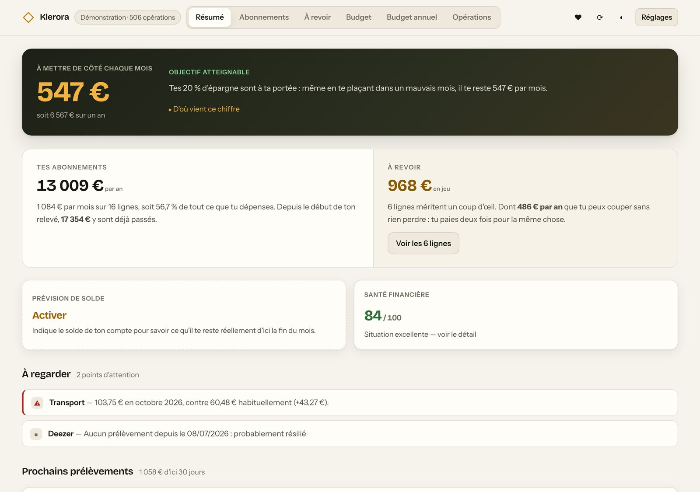
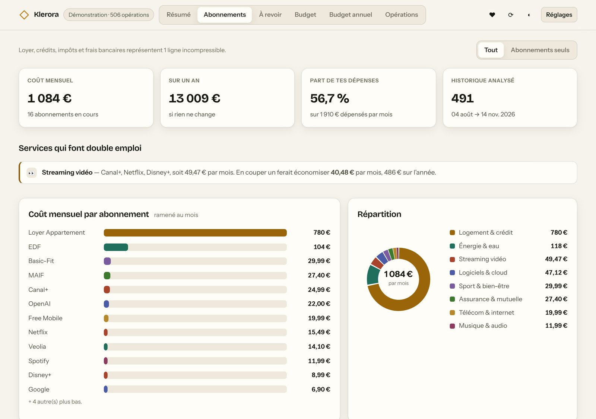
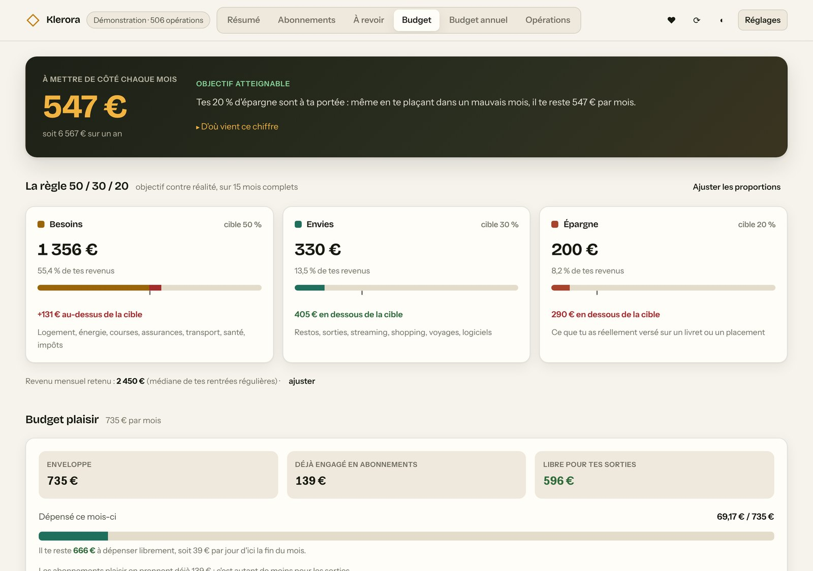

# Klerora

Suivi de budget et détection d'abonnements, pour Windows. Gratuit, sans compte,
100 % local.

**[Télécharger la dernière version](https://klerora.com/telecharger)** · [klerora.com](https://klerora.com)

## Ce que ça fait

- Lit vos relevés bancaires (PDF, Excel, OFX/QFX, QIF, CSV) et retrouve tous vos
  abonnements — leur rythme, leur prochain prélèvement, leurs hausses de tarif.
- Applique la règle 50/30/20 à vos vrais chiffres, avec un simulateur « avant
  achat ».
- Calcule un budget prévisionnel sur douze mois, prévu contre réel, avec
  épargne et crédits.
- Tourne entièrement sur votre ordinateur. Vos relevés ne quittent jamais
  votre machine : il n'y a pas de serveur qui les reçoit.

## Installer

Téléchargez `Klerora.exe` depuis l'onglet
[**Releases**](https://github.com/Velkair/klerora/releases/latest) de ce
dépôt, et double-cliquez dessus. Rien d'autre à installer — pas même un
interpréteur.

Windows 10 ou 11, 64 bits.

## Mises à jour

Klerora vérifie lui-même, via le bouton « Vérifier les mises à jour », s'il
existe une version plus récente ici. S'il y en a une, le fichier téléchargé
est vérifié par empreinte SHA-256 avant d'être installé : rien ne remplace le
programme sans correspondre exactement à ce qui est annoncé.

La seule chose envoyée à GitHub est une demande de numéro de version — aucun
identifiant, aucune statistique, aucune donnée bancaire.

## Code source

Ce dépôt contient les releases, les images et cette documentation — pas le
code source du logiciel.

## Licence

Voir [LICENSE](LICENSE). Logiciel distribué gratuitement en binaire ;
tous droits réservés sur le code et les éléments visuels.

## Contact

[contact@klerora.com](mailto:contact@klerora.com) · [klerora.com](https://klerora.com)

---

© 2026 Velkaïr x Petronas™ — Tous droits réservés.
